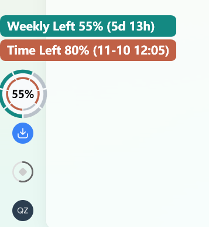

# Reset Ring

[简体中文](README.zh-CN.md)

Reset Ring displays ChatGPT Codex quota and reset times. On Windows it follows the active desktop window. On macOS it appears in the menu bar.

## Why Reset Ring?

Make your paid quota last through the week and put it to use before it resets. Reset Ring shows your remaining quota beside the time left in the current window, so you can decide when to pace your usage and when to tackle work you've been putting off.

- **Running low with days to go?** Save the remaining quota for work you need to finish before the reset.
- **Plenty left with a reset coming up?** Use the available quota on tasks you've been saving.

## Where to find the dial and what the rings mean

On Windows, look near the lower-left corner of the active app window, above the sidebar controls in Codex. On macOS, look in the menu bar.

| Position | Readout |
| --- | --- |
| Outside, when shown | Remaining five-hour quota |
| Middle, or outside in two-ring mode | Remaining weekly quota |
| Inside | Time remaining in the current weekly window |

Codex Plus and accounts with an active five-hour window use three rings. Other accounts use two. Each ring has seven segments. Each segment of the weekly time ring represents one day. The center shows only the remaining weekly quota percentage.

| Normal display | On hover |
| --- | --- |
|  |  |

## Ask AI to install Reset Ring

Paste this into Codex or another AI assistant that can run commands on your computer.

```text
Please install Reset Ring from https://github.com/qz-zhao/reset-ring.
Read the README, detect whether I use Windows or macOS, and follow the steps for my system.
Install it as the $reset-ring skill for ChatGPT Codex.
Start the gauge and verify that it can read my quota. Tell me if I need to sign in or grant access.
```

## Switch colors and language

| Platform | Change palette | Switch Chinese / English |
| --- | --- | --- |
| Windows | Left-click the ring to cycle through Default, Night Flight, Gemstone, Craft, and Sport. | Right-click the ring to switch the hover text. By default it follows the Codex interface language. If the Codex language changes again, the hover text follows that change. |
| macOS | Click the menu bar ring and select a palette by name. | Change the system's preferred language. Quota labels use Chinese when Chinese is first in that list, and English otherwise. |

## Run on Windows

Install PowerShell 7. For Codex, put the Codex CLI on PATH and sign in with ChatGPT. Clone or download this repository and run from its root:

```powershell
pwsh -STA -NoProfile -File scripts/Show-Quota.ps1
```

The overlay follows the foreground ChatGPT Codex desktop window. Keep the terminal open while using it.

## Run on macOS

The macOS menu bar implementation is a preview. It requires macOS 12 or later, the Xcode Command Line Tools, and PowerShell 7 on PATH. For Codex, the signed-in Codex CLI must also be on PATH.

```sh
swift scripts/ResetRing.swift
```

The menu bar displays your ChatGPT Codex quota. Choose a palette or quit from the same menu. Run with `--demo` to preview a simulated Codex Plus dial. The Mac menu adapts to system appearance and uses the system's preferred language for quota labels.

To use Reset Ring as a Codex skill, place this repository folder under `$CODEX_HOME/skills`, or under `~/.codex/skills` if `CODEX_HOME` is unset. Open a new Codex chat and invoke `$reset-ring`.

## Windows controls

- Hover to enlarge the ring in place and see quota details and reset times. The pointer hides over the enlarged ring.
- Left-click to cycle through Default, Night Flight, Gemstone, Craft, and Sport. The rings and tooltip backgrounds change together. Colors adjust to the sidebar's light or dark theme and deepen as each balance falls.
- Right-click to switch the tooltip between Chinese and English. By default the tooltip follows the Codex desktop language. A change in the app's language takes precedence over the manual override.

## Troubleshooting

If the ring overlaps a sidebar control, use `-Left` and `-Bottom` to adjust its center relative to the lower-left corner of the Codex window, in logical pixels.

```powershell
pwsh -STA -NoProfile -File scripts/Show-Quota.ps1 -Left 26 -Bottom 158
```

Use `-Probe` to check account data without opening a window. Use `-Demo` or `-DemoPlus` to test the layout with synthetic data. A dash means the relevant value is unavailable.

Codex data comes from the local Codex App Server under your current sign-in. Reset times use the system time zone.

## License

[MIT](LICENSE)
