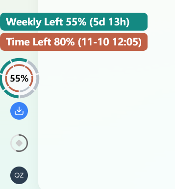

# Reset Ring

[English](README.md)

Reset Ring 显示 ChatGPT Codex 的额度与重置时间。Windows 版贴在当前应用窗口上，macOS 版显示在菜单栏。

## 为什么做 Reset Ring

订阅额度是花钱买来的。用得太快，离重置还有好几天就没额度了。用得太保守，窗口结束时又可能剩下一大截。Reset Ring 把**额度剩余**和**距重置的时间**放在一起，方便你决定什么时候省着用、什么时候把攒着的任务做掉。

- **额度快用完，离重置还早**。把剩余额度留给这几天必须完成的任务。
- **快重置了，余额还很多**。可以安排之前暂缓的任务，把剩余额度用起来。

## 圆盘位置与圆环含义

Windows 版圆盘位于当前应用窗口左下方，在 Codex 里紧挨着侧栏底部控件的上方。macOS 版圆盘位于菜单栏。

| 位置 | 显示内容 |
| --- | --- |
| 最外环（显示时） | 5 小时额度余额 |
| 中环，双环模式下为外环 | 周额度余额 |
| 内环 | 本轮周额度窗口的剩余时间 |

Codex Plus 和存在有效 5 小时额度窗口的账户显示三环，其余情况显示双环。每道环分七格，时间环每格代表一天。圆心只显示周额度剩余百分比。

| 正常显示 | 悬停显示 |
| --- | --- |
|  |  |

## 把这段话发给 AI 安装

复制下面这段话，发给 Codex 或其他能在你电脑上运行命令的 AI 助手。

```text
请帮我从 https://github.com/qz-zhao/reset-ring 安装 Reset Ring。
先读中文 README，识别我用的是 Windows 还是 macOS，按对应步骤检查依赖并安装。
请安装成 ChatGPT Codex 的 $reset-ring skill。Windows 下请同时运行 Set-AppShortcut.ps1，设置桌面 ChatGPT 快捷方式，让打开 GPT 时圆盘一起启动。
启动圆盘并检查能否读取我的额度。如果需要我登录或授权，请告诉我具体在哪一步操作。
```

## 切换配色和中英文

| 系统 | 切换配色 | 切换中英文 |
| --- | --- | --- |
| Windows | 左键点击圆盘，依次切换默认、夜航、宝石、工艺、运动五套配色。 | 右键点击圆盘，切换悬停提示的中英文。默认跟随 Codex 界面语言，Codex 再次切换语言时自动同步。 |
| macOS | 点击菜单栏圆盘，在菜单里选择配色。 | 修改 macOS 的首选语言。中文排在首位时，额度提示显示中文，其余情况显示英文。 |

## 随桌面应用自动启动

Windows 可生成桌面快捷方式，先打开 ChatGPT，再在后台启动圆盘。启动器随即退出。更新后重新运行安装命令，之后使用生成的 **ChatGPT** 快捷方式。

```powershell

pwsh -NoProfile -File scripts/Set-AppShortcut.ps1

```

## Windows 启动

安装 PowerShell 7。使用 Codex 时，还需将已登录 ChatGPT 的 Codex CLI 加入系统路径。克隆或下载本仓库，在仓库目录运行：

```powershell
pwsh -STA -NoProfile -File scripts/Show-Quota.ps1
```

浮层跟随前台的 ChatGPT Codex 桌面窗口。使用时保持终端运行。

## macOS 启动

macOS 菜单栏版目前是预览。需要 macOS 12 或更高版本、Xcode 命令行工具，以及系统路径中的 PowerShell 7。使用 Codex 时，还需将已登录的 Codex CLI 加入系统路径。

```sh
swift scripts/ResetRing.swift
```

菜单栏仪表显示 ChatGPT Codex 的额度，可在菜单里换配色和退出。加 `--demo` 可查看模拟 Plus 三环。菜单栏配色适配系统明暗外观，额度提示跟随系统首选语言。

如果想作为 Codex skill 使用，把仓库文件夹放到 `$CODEX_HOME/skills` 下。若未设置 `CODEX_HOME`，则放到 `~/.codex/skills`。打开新的 Codex 聊天并调用 `$reset-ring`。

## Windows 操作

- 悬停时圆盘在原位放大，指针在圆盘上隐藏，上方显示额度详情和重置时间。
- 左键依次切换默认、夜航、宝石、工艺、运动五套配色。圆环和提示底色成套切换，适配侧栏的明暗主题，并随各自余额减少逐渐加深。
- 右键切换中英文。默认跟随 Codex 界面语言，Codex 切换语言时会覆盖手动选择。

## 排查

如果圆盘遮挡侧栏控件，可以用 `-Left` 和 `-Bottom` 调整圆心距 Codex 窗口左下角的位置，单位为逻辑像素。

```powershell
pwsh -STA -NoProfile -File scripts/Show-Quota.ps1 -Left 26 -Bottom 158
```

用 `-Probe` 检查当前账户数据。用 `-Demo` 或 `-DemoPlus` 查看模拟数据下的布局。短横线表示该项数据暂不可用。

Codex 额度通过本机 Codex App Server 读取，重置时刻按系统时区显示。

## 许可证

[MIT](LICENSE)
